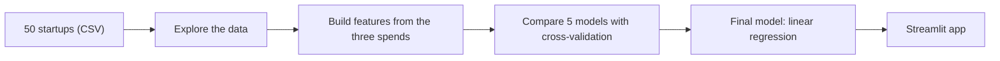

# Startup Profit Predictor

**Enter a budget split. See the predicted profit, how sure the model is, and how your split compares with 50 real startups.**


<!-- After you add a screenshot, remove the arrows around the next line:

-->
<!-- After you deploy, add: **Live app:** https://your-app-link -->

I built this project to practise doing a data project from start to finish: asking questions, exploring the data, comparing models fairly, and turning the result into a small app that people can use.

It uses a practice dataset of 50 startups, so it is a learning project and not advice for a real company.

---

## What the app does

You type in three numbers: **R&D spend**, **administration spend** and **marketing spend**. The app then shows:

| You get | What it means |
|---|---|
| Predicted profit | The model's best guess for that budget |
| A 90% range | A low and a high number, so you can see how unsure the guess is |
| A warning | Shown when your numbers are outside what the model has seen |
| Your place among 50 startups | How the predicted profit compares with the startups in the data |
| Budget split chart | Your split next to the top 25% of startups and the rest |

---

## What I found

| Question | Answer |
|---|---|
| Which spend matters most for profit? | **R&D.** Its correlation with profit is 0.99. Marketing is 0.72 and administration only 0.17. |
| Do fancy models beat a simple line? | **No.** Extra Trees scored an RMSE of 9,007 against 9,369 for a plain linear model, but the spread between folds was about 2,750, so that gap is not a real win. |
| Does adding marketing and administration make predictions better? | **Not really.** Almost all of the prediction comes from R&D. |
| What does one more dollar of R&D go with? | About **81 cents** more profit. Marketing goes with about 3 cents, and administration is not clearly different from zero. |
| How do the best startups spend? | The top 25% (13 startups) put about **55% into marketing, 23% into R&D and 22% into administration**. The others put 44%, 14% and 42%. They also spend more overall. |
| How accurate is the final model? | A typical error of about **9,764** (RMSE) and **7,175** (MAE), measured with cross-validation. |

Four of the 50 startups spent nothing in one category, and I kept them in. The model's biggest miss is one of them: it spent nothing on R&D and made only 14,681, and the model is off by about 35,500 on it.

---

## How it works



- **Features** use only the three spend columns. They live in one file that both the training code and the app use, so the two always match.
- **Model comparison** uses 5-fold cross-validation repeated 10 times (50 scores per model) instead of one small test split, because with 50 startups a single split can be misleading.
- **The 90% range** comes from cross-validation errors. I checked it by building the range without each startup and testing on that startup. It covered about 89% of the cases.

---

## Try it yourself

You need a recent Python (I used 3.14). On Windows PowerShell:

```powershell
python -m venv .venv
.venv\Scripts\Activate.ps1
pip install -r requirements.txt
streamlit run app.py
```

Train the model again:

```powershell
python -m src.model
```

Run the tests:

```powershell
pip install -r requirements-dev.txt
python -m pytest -q
```

The package versions are pinned because the saved model was made with scikit-learn 1.9.1.

---

## What is inside

```
app.py                  Streamlit app
data/                   the 50 startups CSV
docs/                   ideation, findings and cross-validation results
eda/                    analysis scripts (run the # %% cells in VS Code)
models/                 the saved model
src/features.py         features, shared by training and the app
src/model.py            training, the prediction range and predict_profit()
tests/                  14 pytest tests
```

---

## How I built it

1. **Planned it:** wrote down the problem, my questions and hypotheses, and what would prove each one wrong (`docs/00_ideation.md`).
2. **Explored the data:** quality checks, distributions, correlations, the zero-spend startups and the budget mix (`eda/01_eda.py`, notes in `docs/01_eda_findings.md`).
3. **Compared models:** 5 models on 4 feature sets (`eda/02_model_comparison.py`, results in `docs/cv_results.csv`).
4. **Checked the result:** repeated the comparison without the four zero-spend startups, looked at the coefficients with bootstrap ranges, and looked at the biggest errors (`eda/03_sensitivity_and_coefficients.py`).
5. **Built the final model and the app:** `src/model.py` and `app.py`.
6. **Tested it:** tests for the features and the model (`tests/`).

---

## Good to know

- It is based on only 50 startups from one dataset, with no industry, year or country.
- The links I found are not proof of cause. A link between R&D and profit in this data does not mean more R&D would raise the profit of a particular company.
- The 90% range has the same width for every input, so it does not widen for unusual ones. That is why the app shows a warning instead.
- A straight-line model can give nonsense far outside the data. For example, an R&D of 500,000 gives about 455,000, and I would not trust that.

---

## Author

**Arpita Jena**
